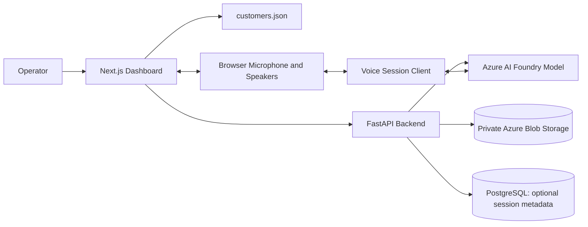

# plan.md — Azure AI Foundry Interactive Payment Follow-up Agent PoC

## 1. Objective

Build a simple browser-based voice-agent PoC using a model deployed in Azure AI Foundry. For now, **do not implement telephony/PSTN calling or choose a calling provider**. Telephony selection and integration are explicitly deferred until the final phase.

The app should:
- Load customer and invoice records from one JSON data file.
- Load customers in order from one JSON data file; do not require customer selection.
- Provide one **Start Agent** button (and End Session control) to start a live voice conversation in the browser for the current customer in the sequence.
- Let the operator/user and AI agent speak and hear each other using the browser microphone and speakers.
- Use the current customer/invoice context for the payment-follow-up conversation.
- When a session is ended and its transcript is finalized/saved, automatically advance to the next JSON customer.
- Capture both agent and user transcript turns and save each session transcript JSON in Azure Blob Storage.
- Show the current customer index (for example, “Customer 1 of N”), session status, and transcript in the dashboard.
- Process the JSON records one by one in their existing order; do not skip or reorder records.

This is a local/controlled POC with synthetic data. It is not a real outbound call.

## 2. Architecture



The browser audio session uses the Azure AI Foundry model for conversational responses. The backend handles access/configuration, trusted customer data, session metadata, and transcript upload. The precise browser-to-Foundry connection method must be chosen based on the actual deployed model and supported Azure SDK/API; do not hardcode an unsupported method. If direct browser access is unsuitable, route audio through a backend session service.

## 3. Stack

| Component | PoC selection |
|---|---|
| UI | Next.js, React, TypeScript |
| API | Python, FastAPI |
| AI | Existing Azure AI Foundry project/model deployment |
| Customer data | Single JSON file initially |
| Transcript persistence | Azure Blob Storage, private container `call-transcripts` |
| Session metadata | In-memory/local for initial POC; PostgreSQL optional if needed |
| Authentication/secrets | Entra ID/Managed Identity where supported; local environment variables for development |

Confirm Foundry endpoint, deployment name, model modality (realtime audio vs text), API version, authentication, and region from the actual Azure project. Keep configuration in environment variables.

## 4. JSON customer list

Create `frontend/public/data/customers.json` (or another documented single JSON location) as the source of demo customer/invoice data. Do not create a customer-management database/API for the first version.

Example:

```json
[
  {
    "customer_id": "cust_demo_001",
    "customer_name": "Aarav Patel",
    "phone_number": "+91XXXXXXXXXX",
    "preferred_language": "English",
    "invoice": {
      "invoice_id": "inv_demo_001",
      "invoice_number": "INV-1001",
      "amount_due": 2500,
      "currency": "INR",
      "due_date": "2026-11-10",
      "payment_status": "unpaid"
    }
  },
  {
    "customer_id": "cust_demo_002",
    "customer_name": "Mira Shah",
    "phone_number": "+91XXXXXXXXXX",
    "preferred_language": "English",
    "invoice": {
      "invoice_id": "inv_demo_002",
      "invoice_number": "INV-1002",
      "amount_due": 1800,
      "currency": "INR",
      "due_date": "2026-11-12",
      "payment_status": "unpaid"
    }
  }
]
```

Use synthetic/placeholder phone numbers. The phone number is display/demo data only; it is not used to place calls in this phase.

## 5. UI requirements

Create a clean, simple dashboard with:
1. Load the customer/invoice records from the JSON file in order.
2. Show the current customer’s name, invoice number, amount, due date, and payment status.
3. Show sequence progress, e.g. `Customer 1 of 20`; optionally show the remaining queue count.
4. One prominent **Start Agent** button starts the browser voice session for the current customer—no customer picker or row selection.
5. Session state: `idle`, `connecting`, `active`, `ending`, `completed`, `failed`.
6. During active session: show mic state and live transcript turns.
7. **End Session** button.
8. After session: show outcome, transcript, and saved-to-Blob status.
9. After finalization, advance automatically to the next customer and return to the ready state. When all records are processed, show `All customers completed` and disable Start Agent.

Only one active voice session at a time in the PoC. Ask for browser microphone permission only after the user presses Start Agent. Handle denied permission and model/session errors clearly.

## 6. Sequential customer processing

- Read the single customer JSON file and preserve its array order.
- Initialize the current customer to the first record (index 0).
- The **Start Agent** button always starts a session for the current record; there is no customer selector.
- Keep one session active at a time.
- On End Session, wait for transcript finalization and successful Blob save (or a clearly handled retry/failure state) before advancing the index.
- Advance exactly one record per finalized session. Use an idempotent finalization guard so duplicate end events do not skip records.
- After advancing, show the next customer and update progress (`Customer n of N`); the operator can press Start Agent to begin the next conversation.
- When all records are processed, show a completion message and disable Start Agent.
- Do not automatically initiate the next conversation without the operator pressing Start Agent.

## 7. Voice interaction and agent behavior

The interaction is a browser voice conversation, not a phone call. Both the operator/user and the agent can be heard through the computer's microphone and speakers.

Agent prompt draft:

> You are a polite payment follow-up assistant for the configured organization. You are speaking in a browser-based demo session, not placing a phone call. Use only customer and invoice facts supplied by the application. Briefly identify yourself and explain the invoice amount and due date. Ask whether the customer has already paid or when they expect to pay. If they say they paid, record `reported_paid` without claiming that payment is verified. If they offer a payment date, record `payment_promised`. If they request a callback, dispute the invoice, ask for a human, or do not wish to continue, record the relevant outcome and respond politely. Do not request OTP, UPI PIN, CVV, card number, password, bank credentials, or payment authentication data. Do not threaten, shame, pressure, or invent facts. Keep responses concise.

Possible outcomes:
- `payment_promised` (optional date)
- `reported_paid` (customer report only)
- `callback_requested`
- `disputed_invoice`
- `needs_human_review`
- `stop_requested`
- `completed_no_commitment`
- `technical_failure`

Backend validates outcome/date fields; model output alone is not authoritative.

## 8. Transcript requirements

Capture every conversation turn from both speakers:
- `speaker`: `agent` or `user`
- `text`
- `timestamp`
- optional `turn` index

Transcript must be saved after the session ends or is finalized. If the session fails, save any transcript captured so far with status `failed` where possible.

Example transcript JSON:

```json
{
  "schema_version": "1.0",
  "session_id": "session_demo_001",
  "customer_id": "cust_demo_001",
  "invoice_id": "inv_demo_001",
  "started_at": "2026-11-16T10:00:00Z",
  "ended_at": "2026-11-16T10:02:15Z",
  "session_status": "completed",
  "outcome": "payment_promised",
  "promised_payment_date": "2026-11-20",
  "transcript": [
    {
      "turn": 1,
      "speaker": "agent",
      "text": "Hello, I am the payment follow-up assistant...",
      "timestamp": "2026-11-16T10:00:05Z"
    },
    {
      "turn": 2,
      "speaker": "user",
      "text": "I can pay on Friday.",
      "timestamp": "2026-11-16T10:00:12Z"
    }
  ],
  "summary": "The user indicated a payment date."
}
```

Blob naming:
`{yyyy}/{mm}/{customer_id}/{session_id}/transcript.json`

Use a private Azure Blob container, managed identity/least-privilege RBAC in Azure, encryption, and an appropriate retention policy. Store a blob name/reference and session metadata in the app. Do not make the container public. Do not store audio recordings in this initial POC—text transcript only.

## 9. Backend/API outline

Minimal endpoints:
- `GET /api/customers` — read and return the JSON customer list.
- `POST /api/sessions` — create session metadata for the current customer/invoice in the sequential queue.
- `POST /api/sessions/{session_id}/transcript` — receive/finalize transcript and upload JSON to Blob.
- `GET /api/sessions` — list session history (optional for first version).
- `GET /api/sessions/{session_id}/transcript` — authorized transcript retrieval (optional if UI uses session state and only saves).

Do not create telephony endpoints, provider webhooks, call queues, call scheduling, or phone dialing in this phase.

## 10. Suggested repository structure

```text
payment-followup-poc/
├── frontend/
│   ├── app/
│   │   ├── dashboard/
│   │   └── sessions/
│   ├── components/
│   │   ├── CustomerList.tsx
│   │   ├── VoiceSessionPanel.tsx
│   │   └── TranscriptPanel.tsx
│   └── public/data/customers.json
├── backend/
│   ├── app/
│   │   ├── main.py
│   │   ├── api/routes/
│   │   ├── schemas/
│   │   └── services/
│   │       ├── foundry_session.py
│   │       └── transcript_storage.py
│   └── tests/
├── .env.example
└── README.md
```

## 11. Environment configuration

```dotenv
AZURE_AI_FOUNDRY_ENDPOINT=
AZURE_AI_FOUNDRY_DEPLOYMENT=
AZURE_AI_FOUNDRY_API_VERSION=
AZURE_AI_FOUNDRY_KEY=
AZURE_STORAGE_ACCOUNT_URL=
AZURE_STORAGE_CONTAINER=call-transcripts
```

Use `.env` locally only; never commit secrets. Prefer Managed Identity/Entra ID for deployed Azure services where supported. Avoid exposing long-lived Foundry keys to frontend code. If browser sessions require a short-lived token, mint it securely through backend using the supported Foundry authentication pattern.

## 12. Milestones

### M1 — App foundation and JSON data
- Inspect repository, scaffold only if needed.
- Build Next.js dashboard and FastAPI backend.
- Add the single customers JSON file with synthetic data.
- Display the current customer and invoice details from the first JSON record, with sequence progress.
- Add tests for JSON parsing, sequence ordering, and advancing to the next record.
- **Exit:** first customer renders from JSON, no customer picker exists, and sequential progression logic passes tests.

### M2 — Foundry text conversation prototype
- Verify Azure AI Foundry model/deployment and authentication.
- Connect backend to model.
- Test payment-follow-up prompts using typed user input before voice.
- Validate structured outcomes and optional promised date.
- **Exit:** demo conversation returns sensible responses grounded in provided JSON data.

### M3 — Browser voice session
- Verify deployed model supports realtime audio/browser interaction or establish supported backend audio relay.
- Implement Start Agent, microphone permission, speaker output, and End Session.
- Show session status and live transcript turns for both agent and user.
- Handle permission denial, connection errors, interruption, and session termination.
- **Exit:** operator can speak and hear agent in browser; both sides' transcript turns are captured.

### M4 — Azure Blob transcript saving
- Create private Blob container.
- Implement transcript JSON upload.
- Upload transcript on End Session and persist session/blob reference.
- Show saved status and transcript in UI.
- Test upload failures and retry behavior.
- **Exit:** transcript from a completed browser conversation is stored in Blob and viewable through authorized app flow.

### M5 — POC validation and demo polish
- Test varied user replies: paid, payment promise, callback request, dispute, stop, etc.
- Ensure agent does not solicit sensitive payment credentials or fabricate facts.
- Add clear errors, loading states, session timestamps, and demo instructions.
- Review consent/privacy and retention considerations before using real customer data.
- **Exit:** repeatable browser-based demo with customer JSON → Start Agent → spoken conversation → transcript saved in Blob.

### M6 — Telephony evaluation (last; deferred)
- Only after the browser-based POC is approved, research and compare telephony options.
- Confirm outbound call capability, target-country support, audio streaming, webhook support, pricing, compliance, and Foundry interoperability.
- Do not implement or select a telephony provider until explicitly approved.
- This milestone is future work and must not block M1–M5.

## 13. Test checklist

- Customer JSON loads, schema is validated, and records are processed in file order.
- Start Agent uses the current sequence record; no customer selection is required.
- After session finalization, sequence advances exactly once; duplicate finalization must not skip a customer.
- End of JSON queue is handled gracefully and Start Agent is disabled.
- Microphone permission denial is handled gracefully.
- Both `agent` and `user` turns are captured with timestamps.
- End Session finalizes the transcript; interruption/session failure preserves partial transcript.
- Blob upload works; unauthorized transcript access is denied.
- Model output is validated; no invented invoice facts.
- Agent never asks for OTP, UPI PIN, CVV, card number, password, or bank credentials.
- Test outcomes: payment promised, reported paid, callback, dispute, human review, stop requested.

## 14. Instructions for coding LLM

1. Read this plan fully and inspect the repository before modifying anything.
2. Implement milestones in order. The immediate task is M1.
3. Telephony is intentionally undecided and deferred to M6. Do not add telephony SDKs, providers, PSTN calling, scheduling, or webhooks in M1–M5.
4. Use exactly one JSON file as the initial source for customer/invoice list data.
5. Use Azure AI Foundry model deployment for the agent; verify actual capability and API compatibility before coding the voice path.
6. Keep Foundry session handling and Blob storage behind clean service interfaces.
7. Do not expose credentials in frontend bundles or source control.
8. Use synthetic customer data and text transcripts; no audio recording in this POC.
9. At the end of each milestone, report changed files, commands, tests, configuration needed, and next milestone.

## First coding task

> Inspect the current repository. If it is empty, scaffold a Next.js TypeScript dashboard and FastAPI backend. Add `customers.json` containing synthetic customer and invoice entries in a defined order. Render the first customer/invoice record and sequence progress; implement a placeholder Start Agent/End Session UI with no customer picker or manual selection. Add tests for JSON schema, file ordering, and next-record advancement. Do not integrate voice, Blob storage, or telephony in this first task. Report setup commands and test results.
